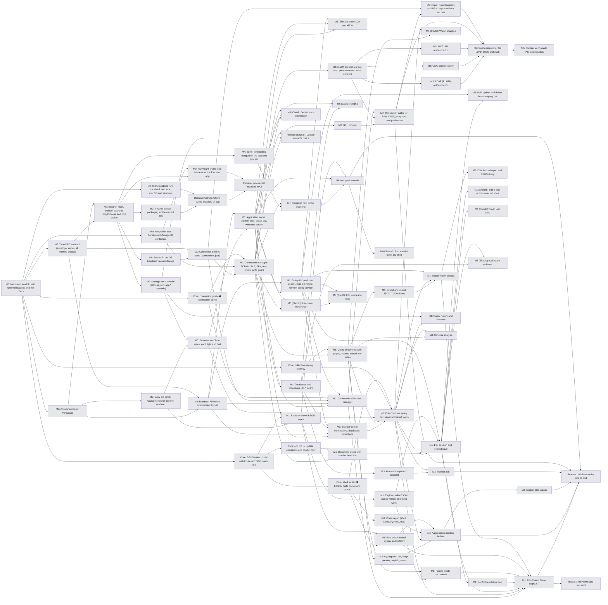

# Task board

| Task | Status | Owner | Unblocks | Ready |
|---|---|---|---|---|
| scaffold | todo |  | 73 | yes |
| renderer-scaffold | todo |  | 63 |  |
| contract | todo |  | 62 |  |
| electron-shell | todo |  | 60 |  |
| int-harness | todo |  | 46 |  |
| secrets-store | todo |  | 46 |  |
| profiles-store | todo |  | 45 |  |
| uri-model | todo |  | 45 |  |
| conn-manager | todo |  | 43 |  |
| app-settings | todo |  | 39 |  |
| explorer-copy | todo |  | 39 |  |
| themes | todo |  | 38 |  |
| api-client | todo |  | 34 |  |
| app-layout | todo |  | 33 |  |
| bson-model | todo |  | 28 |  |
| safety-ui | todo |  | 26 |  |
| bson-display | todo |  | 23 |  |
| paging-core | todo |  | 22 |  |
| browse-backend | todo |  | 21 |  |
| docs-query-backend | todo |  | 21 |  |
| shell-syntax | todo |  | 20 |  |
| sidebar-tree | todo |  | 18 |  |
| collection-view | todo |  | 17 |  |
| bson-inputs | todo |  | 10 |  |
| diff-ops | todo |  | 10 |  |
| docs-write-backend | todo |  | 9 |  |
| doc-edit-save | todo |  | 8 |  |
| x509-proxy | todo |  | 8 |  |
| connection-ui | todo |  | 7 |  |
| io-basic-backend | todo |  | 5 |  |
| raw-editor | todo |  | 5 |  |
| ssh-tunnel | todo |  | 5 |  |
| conn-ui-m2 | todo |  | 4 |  |
| io-basic-ui | todo |  | 4 |  |
| mongosh-spike | todo |  | 4 |  |
| agg-backend | todo |  | 3 |  |
| codegen | todo |  | 3 |  |
| conflict-ui | todo |  | 3 |  |
| doc-paging | todo |  | 3 |  |
| shell-backend | todo |  | 3 |  |
| agg-ui | todo |  | 2 |  |
| aws-auth | todo |  | 2 |  |
| ci-check | todo |  | 2 |  |
| index-backend | todo |  | 2 |  |
| ldap-auth | todo |  | 2 |  |
| m1-e2e | todo |  | 2 |  |
| oidc-auth | todo |  | 2 |  |
| packaging | todo |  | 2 |  |
| profiles-import-export | todo |  | 2 |  |
| shell-ui | todo |  | 2 |  |
| auth-ui-m5 | todo |  | 1 |  |
| e2e-harness | todo |  | 1 |  |
| explain-ui | todo |  | 1 |  |
| index-ui | todo |  | 1 |  |
| release-ci | todo |  | 1 |  |
| users-roles-view | todo |  | 1 |  |
| aws-verify | todo |  | 0 |  |
| bulk-ops-ui | todo |  | 0 |  |
| change-streams | todo |  | 0 |  |
| currentop | todo |  | 0 |  |
| final-demo | todo |  | 0 |  |
| gridfs | todo |  | 0 |  |
| installer-smoke | todo |  | 0 |  |
| io-advanced | todo |  | 0 |  |
| multi-doc-edit | todo |  | 0 |  |
| query-history | todo |  | 0 |  |
| readme | todo |  | 0 |  |
| schema-analysis | todo |  | 0 |  |
| server-stats | todo |  | 0 |  |
| shell-scripts | todo |  | 0 |  |
| undo-last-save | todo |  | 0 |  |
| update-notice | todo |  | 0 |  |
| users-roles-edit | todo |  | 0 |  |
| validator | todo |  | 0 |  |
