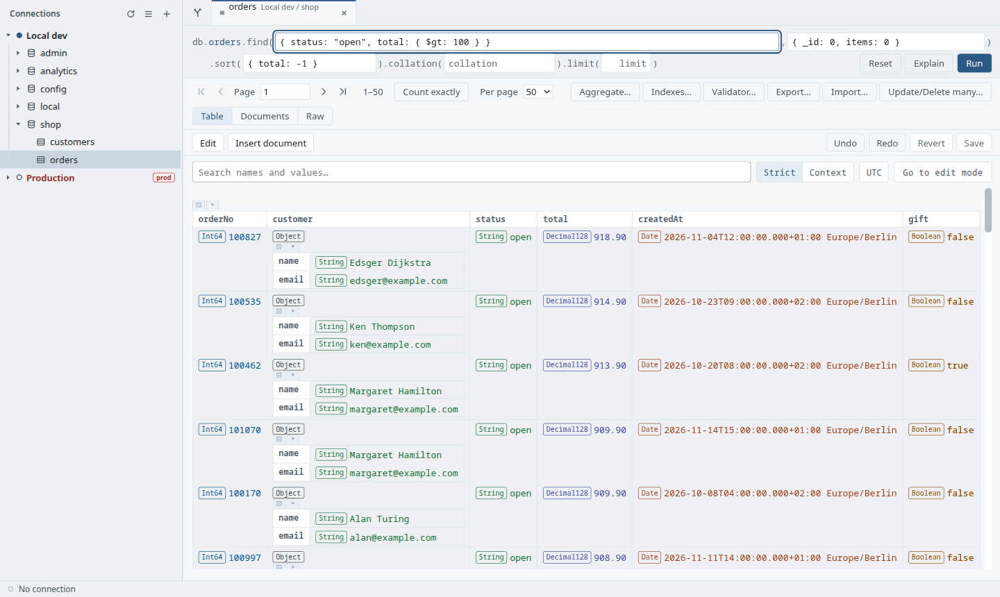
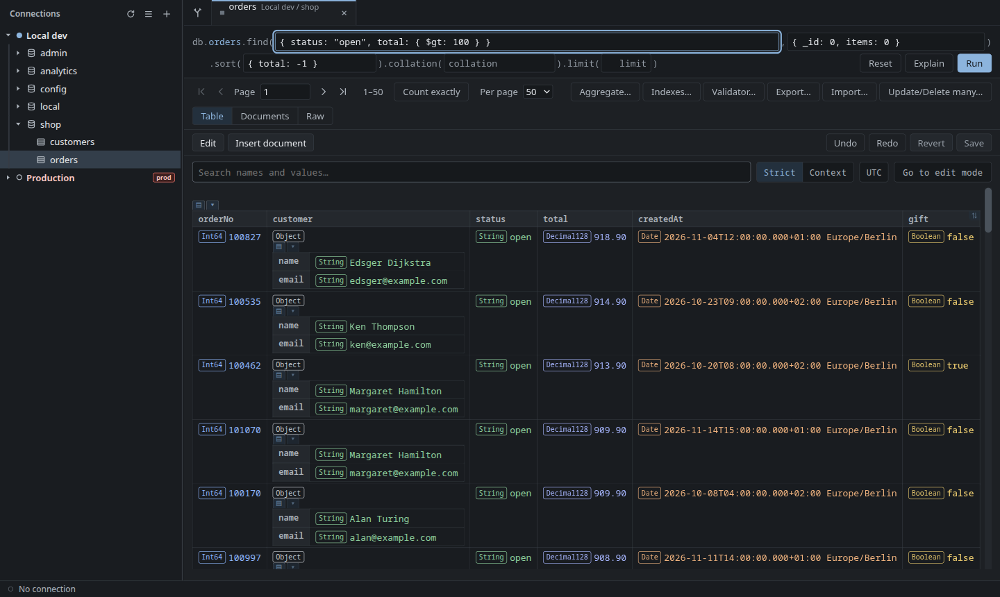
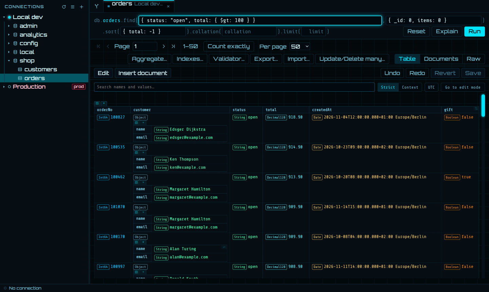
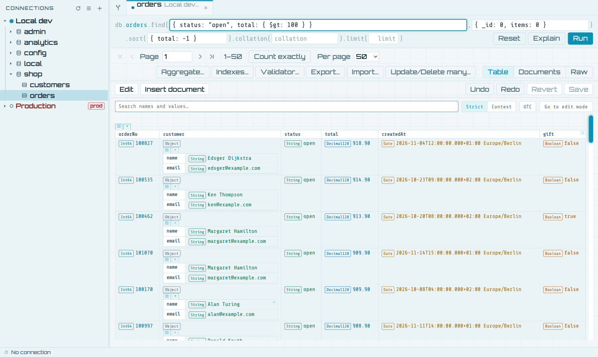

# Thicket

**A desktop client for MongoDB** for Linux, macOS and Windows. Thicket is open source (Apache-2.0).
Its document editor shows nested tables and forms instead of a JSON text box. Every BSON type is
shown and edited as itself, and nothing is written to the server until you click **Save**.



| Business, dark | Tron, dark | Tron, light |
| --- | --- | --- |
|  |  |  |

Thicket has two visual styles, **Business** (the default: calm and compact) and **Tron** (glowing
neon). Each comes in a light and a dark mode, or can follow the system. Pick them in the settings.

## Features

**Connections**

- Connection profiles with a name, a color and a folder. Edit them as a connection string or in a
  form; changes in one show up in the other.
- `mongodb+srv://` (Atlas), standalone, replica sets, sharded clusters (mongos) and
  `directConnection`.
- Authentication: SCRAM-SHA-1/256, X.509 client certificates, LDAP (PLAIN), OIDC (browser sign-in
  or device flow) and AWS IAM.
- TLS with your own CA file; an always-visible warning when certificate checks are turned off.
- SSH tunnels (password, private key or SSH agent, with a known-hosts check) and SOCKS5 proxies.
- Read preference and write concern per profile.
- Passwords and other secrets are kept in the OS keychain, never in plain text. You can also choose
  "ask for the password each time".
- **Test connection** explains what went wrong (DNS, TLS, authentication, timeout).
- Import connections from MongoDB Compass or from a list of connection strings. Export profiles
  without their secrets to share them with your team.

**Browsing and querying**

- A sidebar with databases, collections, views and time series collections. Document counts and
  sizes are loaded on demand.
- Create, drop and rename databases and collections. To drop one, you type its name.
- A query bar for filter, projection, sort, collation and limit, written in shell syntax
  (`{ status: "open", total: { $gt: 100 } }`).
- Paging with 20, 50, 100 or 500 documents per page and jump-to-page. Counts are estimated unless
  you ask for an exact count, and long queries can be cancelled.
- Three result views: a table with one row per document, a document list, and raw text (shell
  syntax or Extended JSON).

**Editing documents**

- Every BSON type is first-class: ObjectId, Date, String, Int32, Int64, Double, Decimal128,
  Boolean, Null, Object, Array, Binary (UUIDs shown as UUIDs), Regex, Timestamp, Code, MinKey and
  MaxKey. Each value shows a type badge.
- Editing a value never changes its type. A number typed into an Int64 field stays an Int64. To
  change a type, use the type menu.
- Large arrays and objects are paged inside the document. Big documents load their arrays a page
  at a time.
- A raw editor in shell syntax (`ObjectId("…")`, `ISODate("…")`, `NumberLong(…)`) or canonical
  Extended JSON. It parses your text and never runs it as code.
- Edits stay local until you click **Save**. Before that you can undo, redo or revert them.
- **Save** sends only the fields that changed (`$set`/`$unset`). If someone else changed the same
  document since you loaded it, Thicket shows both versions side by side. You can then overwrite,
  keep the server version or merge by hand.
- Insert, clone and delete documents.

**Safety**

- **Read-only** profiles turn off every write, and the app's backend refuses writes too.
- **Production** profiles get a red accent, and every write shows the operation and asks you to
  confirm.
- Bulk update and delete always show the number of matching documents and a sample first. To delete
  more than 1 000 documents, you type the collection name.

**Power tools**

- Aggregation pipeline builder: add, disable and reorder stages, with a preview after each stage.
  Edit one stage at a time or the whole pipeline as text. Save pipelines, create a view from a
  pipeline, and export it as shell, Node.js, Python or Java code.
- Explain plans for find and aggregate, shown as a tree of stages with keys and documents examined,
  time and the index used.
- Index management: list indexes with size and usage, create any index type (unique, sparse,
  partial, TTL, collation, hidden, text, 2dsphere, wildcard), drop, hide and unhide.
- Collection validators (`$jsonSchema`): view and edit them, with validation level and action.
- Import and export as JSON (Extended JSON, relaxed or canonical) and JSON Lines.
- An embedded **mongosh** console for each connection, with history, multi-line input and
  autocompletion. Results open in Thicket's document viewer.
- A read-only view of users and roles.

**Planned:** schema analysis, CSV and BSON dump import/export, editing a field across several
documents, query history and favorites, currentOp/killOp, an "update available" notice, and more.
The full plan is in [SPEC.md](SPEC.md).

Thicket sends no telemetry. It only talks to the servers you configure.

## Install

Download the installer for your system from the
[GitHub releases page](https://github.com/OldPeasant/thicket/releases), together with
`SHA256SUMS.txt`.

| System | File |
| --- | --- |
| Linux x64 / arm64 | `.AppImage` (any distribution), `.deb` (Debian, Ubuntu), `.rpm` (Fedora, RHEL, openSUSE) |
| macOS (Apple Silicon / Intel) | `thicket-<version>-mac-arm64.dmg` / `thicket-<version>-mac-x64.dmg` |
| Windows x64 | `thicket-<version>-win-x64.exe` (installer) or `thicket-<version>-win-x64.zip` (portable) |

> [!IMPORTANT]
> The builds are **not code-signed yet**. On macOS, Gatekeeper says the app "cannot be opened
> because Apple cannot check it for malicious software". On Windows, SmartScreen says "Windows
> protected your PC". To open the app anyway, follow the steps for your system in the
> [install guide](docs/user/install.md).

Quick start on Linux with the AppImage:

```sh
sha256sum --check --ignore-missing SHA256SUMS.txt
chmod +x thicket-<version>-linux-x86_64.AppImage
./thicket-<version>-linux-x86_64.AppImage
```

The [install guide](docs/user/install.md) has the steps for each system, the macOS and Windows
warnings, where Thicket stores its data, and how to uninstall it.

## Build from source

You need Node.js 24.15 or newer (see [`.nvmrc`](.nvmrc)), npm and git. On Linux you also need
`rpmbuild` to build the `.rpm` package.

```sh
git clone https://github.com/OldPeasant/thicket.git
cd thicket
npm ci          # installs all workspaces
npm run start   # builds the app and starts it
npm run dist    # unsigned installers for your current OS in apps/desktop/release/
```

[docs/ARCHITECTURE.md](docs/ARCHITECTURE.md) explains the layout, the tools needed on each OS
("Install") and all the commands.

## Contributing

Contributions are welcome. Open an issue first for larger changes.

1. Read [SPEC.md](SPEC.md) for what Thicket does, and [docs/ARCHITECTURE.md](docs/ARCHITECTURE.md)
   for how it is built and its conventions.
2. Put tests next to the code (`*.spec.ts`). `npm run check` runs lint, the type check and the unit
   tests; it must pass. `npm run format` applies Prettier.
3. If your change touches server access, run the integration tests (`npm run test:int`). They need
   Docker or Podman. For UI flows, run the end-to-end tests (`npm run test:e2e`).
4. Never commit secrets, certificates or keys; tests generate them at test time.
5. Write commit messages in the imperative mood ("Add index hiding").

## License and trademarks

Thicket is licensed under the Apache License 2.0; see [LICENSE](LICENSE). It includes code from
[JSON Canopy](https://github.com/OldPeasant/json-canopy); see [NOTICE](NOTICE) for that and for
third-party components.

"MongoDB" is a registered trademark of MongoDB, Inc. Thicket is an independent project. It is not
affiliated with, endorsed by or sponsored by MongoDB, Inc.
